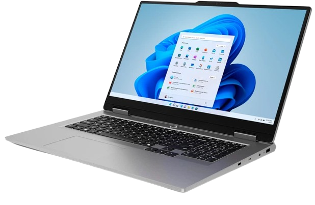

  

<h1 align="center">
  Hi there, I'm Vladislav! 
  
</h1>

<!-- Анимация текста: теперь печатает всё сразу в одну строку и не стирает -->

  

<!-- Бейджи специальностей и локации (видно сразу) -->

  
  
  
  

<!-- Счетчик просмотров профиля -->

  

---

### 🌐 Spoken Languages & 🛠 Tech Stack

<table>
  <tr>
    <td valign="top" width="50%">
      <h4 align="center">🗣 Languages</h4>
      

         
         
        
      

    </td>
    <td valign="top" width="50%">
      <h4 align="center">💻 Tech Stack & Tools</h4>
      

        
        &nbsp;&nbsp;
        
        &nbsp;&nbsp;
        
        &nbsp;&nbsp;
        
        &nbsp;&nbsp;
        
      

    </td>
  </tr>
</table>

---

### 🤖 My Coding Agents

  
  
  

---

### 💻 My Device

<table align="center">
  <tr>
    <td valign="center" width="60%">
      <h4>
         
        &nbsp;LOQ 15 (83JH000JUS)
      </h4>
      <ul>
        <li>⚡ <b>CPU:</b> 13th Gen Intel® Core™ i5-13450HX</li>
        <li>🎮 <b>GPU:</b> NVIDIA GeForce RTX 5050M</li>
        <li>🧠 <b>RAM:</b> 12 GB DDR4</li>
      </ul>
    </td>
    <td valign="center" align="center" width="40%">
      
    </td>
  </tr>
</table>

---

### ⭐ Featured Projects (Избранные проекты)
<!-- ⚠️ ЗАМЕНИ "REPO_NAME_1" и "REPO_NAME_2" НА ТОЧНЫЕ НАЗВАНИЯ ТВОИХ РЕПОЗИТОРИЕВ НА GITHUB -->

  
  

---

### 🏆 GitHub Trophies

  

---

### 📊 My GitHub Stats & Streak

  
  

  

  

